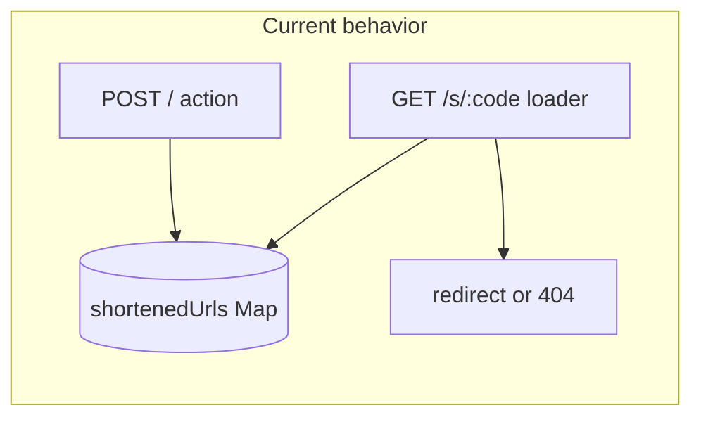

# Testing baseline (Vitest + route handler integration)

## Goals

- **Lock current behavior** before persistence/repository work: same validation messages, same redirect/404 semantics, same short-code shape, same `baseUrl` display rules.
- **No production code changes** — only new devDependencies, config, and test files. Use existing `[shortenedUrls](libs/engine/src/shortened-url.ts)` export to `**clear()` the map in `beforeEach`** (test-only; does not alter app behavior).
- **Integration-first, minimal**: treat **direct invocation of real route `loader` / `action` functions** as integration tests (full module graph + real in-memory store), not duplicated logic. Skip Playwright/Cypress for now to avoid extra stack and server orchestration; that matches “avoid over-engineering” while still covering main flows.

## Why `react-router typegen` is required

Route modules import types from `[./+types/_index](applications/web/app/routes/_index.tsx)` and `[./+types/s.$code](applications/web/app/routes/s.$code.tsx)`. Those are generated into `[applications/web/.react-router/](applications/web/.gitignore)` (gitignored). **Vitest cannot resolve `./+types/*` until typegen runs.**

- **Web test script** should be: `react-router typegen && vitest run` (mirror existing `[typecheck](applications/web/package.json)` pattern).

## Package layout

| Location                               | Role                                                                                 |
| -------------------------------------- | ------------------------------------------------------------------------------------ |
| `[libs/engine](libs/engine)`           | Vitest (Node env), tests for `generateShortCode`                                     |
| `[applications/web](applications/web)` | Vitest + minimal Vite config for TSX/aliases, tests that import real loaders/actions |

## Tooling choices

- **Vitest** — aligns with Vite-based `[applications/web/vite.config.ts](applications/web/vite.config.ts)`; fast; no Jest ecosystem drift.
- **Web Vitest config** — use a **dedicated** `[applications/web/vitest.config.ts](applications/web/vitest.config.ts)` with `@vitejs/plugin-react` + `vite-tsconfig-paths` for `@url-shortener/engine` resolution. **Do not** enable `@react-router/dev/vite` in the test config (avoids dev-server/build coupling; matches common RR7 + Vitest guidance).
- **Environment** — `environment: "node"` for web route-handler tests (loaders/actions are server code).

## Tests to add (minimum set)

### 1. Engine — `[libs/engine/src/shortened-url.test.ts](libs/engine/src/shortened-url.test.ts)` (new)

Assert **current** `generateShortCode` contract (document behavior, don’t “fix” it):

- Returned string has **length 2**
- Every character is in `**abc`**
- Run a small loop (e.g. 20 draws) to sanity-check it stays in that space (not a statistical proof; enough to catch accidental refactors)

No need to test the `Map` itself unless you want one trivial test that `set`/`get` round-trip works (optional; low value).

### 2. Web — `applications/web/tests/routes.integration.test.ts` (new)

Import **real** exports from `[app/routes/_index.tsx](applications/web/app/routes/_index.tsx)` and `[app/routes/s.$code.tsx](applications/web/app/routes/s.$code.tsx)`.

Use `**vi.resetModules()` + dynamic `import()`** (or `vi.stubEnv`) for the `**PUBLIC_URL` unset** case so `[baseUrl](libs/engine/src/base-url.ts)` re-evaluates; for the common path, set `PUBLIC_URL` in a Vitest `**setupFiles`** entry so `[loader](applications/web/app/routes/_index.tsx)` returns `{ baseUrl: "…/s/" }` vs `"-"`.

**Index route**

- **Loader**: with `PUBLIC_URL` set → `baseUrl` ends with `/s/`; without → `"-"` (current lines 9–12).
- **Action**:
  - Missing/empty `url` in `FormData` → `{ error: "URL is required" }` (current lines 19–21).
  - Valid URL → `{ shortenedUrl: "${baseUrl}/s/${code}" }` where `code` matches **current** generator (length 2, charset `a|b|c`). Extract code from the returned string with a regex; assert `shortenedUrls.get(code) ===` submitted URL.

**Short-code redirect route**

- Seed `shortenedUrls.set("aa", "https://example.com")` then call `loader` with `params.code === "aa"`.
  - Expect a **redirect `Response`**: status **302** (or framework equivalent) and `**Location: https://example.com`** (or relative—assert what RR actually returns today).
- Unknown code → `**throw` a `Response` with status 404** and body `"Not Found"` (current `[s.$code.tsx](applications/web/app/routes/s.$code.tsx)` lines 10–12).

*Implementation note:* Construct minimal `LoaderArgs` / `ActionArgs`-shaped objects (`request`, `params`, `context`) — use typegen-backed types after `typegen` so you avoid `any` where possible.

## Monorepo wiring

- `**[libs/engine/package.json](libs/engine/package.json)`**: add `vitest` devDependency; script `"test": "vitest run"`.
- `**[applications/web/package.json](applications/web/package.json)`**: add `vitest`, `@vitejs/plugin-react` devDependencies; script `"test": "react-router typegen && vitest run"`.
- `**[turbo.json](turbo.json)`**: add `test` task (outputs optional: coverage if you add it later; start with no outputs for simplicity).
- **Root `[package.json](package.json)`**: `"test": "turbo test"` so CI/local runs both packages.

## Out of scope (deliberately)

- Playwright/e2e against `pnpm start` (valuable later; extra CI wiring).
- Testing default React components with `createRoutesStub` (RR docs warn about type friction with framework `Route.ComponentProps`; not needed to lock server behavior).
- Changing `[Dockerfile](Dockerfile)` to run tests (optional follow-up).

## Data flow (what you’re locking)

Tests anchor **FormPOST** and **GETs** behavior before swapping **Map** for DB + repository.