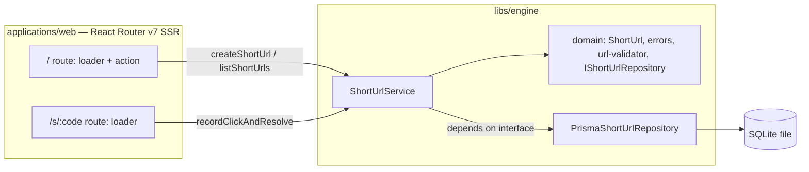

# URL Shortener

**Full-stack URL shortener with database persistence.** Submit a URL, get a short redirect link, and track clicks — refactored from a deliberately flawed take-home starter into a layered, tested application. See [CHALLENGE_SUBMISSION.md](./CHALLENGE_SUBMISSION.md) for what changed and why.

## Tech Stack

| Technology                                    | Description                                                                                        |
| ---------------------------------------------- | --------------------------------------------------------------------------------------------------- |
| [pnpm](https://pnpm.io/)                      | Fast, disk-efficient package manager with built-in monorepo support via workspaces                  |
| [Turbo](https://turbo.build/)                 | High-performance build system for monorepos. Runs tasks in parallel and caches results              |
| [React](https://react.dev/)                   | Library for building user interfaces with components                                                |
| [React Router v7](https://reactrouter.com/)   | Full-stack React framework. Handles routing, data loading (loaders), mutations (actions), and SSR — the only server layer, no separate Express/Fastify process |
| [TypeScript](https://www.typescriptlang.org/) | Typed superset of JavaScript for catching errors at compile time                                    |
| [Tailwind CSS](https://tailwindcss.com/)      | Utility-first CSS framework for rapid UI development                                                |
| [Radix UI / shadcn-style components](https://ui.shadcn.com/) | Accessible component primitives, copied into the repo and restyled with our own theme tokens |
| [Vite](https://vite.dev/)                     | Fast build tool and dev server with hot module replacement                                          |
| [Prisma](https://www.prisma.io/) + SQLite     | ORM and file-backed database, persisted via a Docker volume                                         |
| [Vitest](https://vitest.dev/)                 | Unit/integration test runner                                                                        |

## Local Setup

```bash
pnpm install
cp .env.example .env
pnpm dev
```

Open `http://localhost:5173`

## Docker Setup

```bash
pnpm docker:up      # docker compose up --build
pnpm docker:down    # docker compose down (keeps the data volume)
```

Open `http://localhost:3000`

The SQLite database file lives on a named volume (`sqlite-data`), so data survives `docker:down` / `docker:up` cycles. `pnpm docker:down:clean` removes the volume along with it. `PUBLIC_URL` and `DATABASE_URL` for the container are set directly in `docker-compose.yml`, overriding whatever is in `.env`.

## Environment variables

> Full comments live in `.env.example`.

| Variable      | Required | Default (local)          | Notes                                                                 |
| ------------- | -------- | ------------------------- | ---------------------------------------------------------------------- |
| `NODE_ENV`    | No       | `development`             | Set to `production` by `docker-compose.yml`                            |
| `PUBLIC_URL`  | No       | `http://localhost:5173`   | Base URL used to build the displayed short link; `docker-compose.yml` overrides it to `http://localhost:3000` |
| `DATABASE_URL`| Yes      | `file:./dev.db`           | SQLite file path, resolved relative to `libs/engine/prisma/schema.prisma`; overridden in Docker to `file:/app/data/prod.db` (the mounted volume) |

## Architecture

`libs/engine` is a layered domain library; `applications/web`'s React Router loaders/actions are thin HTTP adapters over it — there is no separate backend server.



`domain/` and `application/` never import `@prisma/client`, `react-router`, or read `process.env` — `PrismaShortUrlRepository` is the only file that imports Prisma, and the route layer reads `PUBLIC_URL`/env and passes it in as a plain argument.

## Design decisions and tradeoffs

| Decision                                                        | Why                                                                                                   | Tradeoff                                                                        |
| ----------------------------------------------------------------| ------------------------------------------------------------------------------------------------------| ---------------------------------------------------------------------------------|
| SQLite + Prisma over Postgres                                   | No extra container, no connection/network wiring, and the challenge explicitly encourages Prisma      | Single-instance only; wouldn't horizontally scale as-is                        |
| DB `UNIQUE` constraint as the authoritative uniqueness guarantee| A pre-insert `SELECT`-then-`INSERT` check-then-act is a race condition under concurrent requests       | A collision surfaces as a caught error + in-app retry, not a free check         |
| `IShortUrlRepository` interface, one Prisma-backed implementation| Keeps `domain`/`application` unit-testable with a fake repository, no DB needed for those tests        | The interface has only one real implementation — added for testability/layering, not present multi-backend need |
| `baseUrl` passed as a parameter, not read from `process.env` in `libs/engine` | Keeps the domain/application layers free of runtime-config concerns; the route layer already owns env access | One extra argument threaded through `createShortUrl`                            |
| Click stats as `clickCount` + `lastClickedAt` columns, not a `ClickEvent` log | Satisfies the listing/stats requirement with one atomic `UPDATE`, no second table                      | No per-click history (referrer, timestamp series, user agent) — deferred        |
| In-memory, per-IP sliding-window rate limiting                  | Sufficient for a single-instance take-home; a distributed limiter (Redis) is explicit overkill here    | State resets on restart and isn't shared across instances                       |
| shadcn-style components (Radix + Tailwind), restyled with our own tokens | Directly matches the challenge's suggestion and the accessible-primitives idiom it's evaluating for   | More setup than hand-rolled Tailwind-only components would have needed for this app's complexity |

## Known limitations and next steps

This was built inside a ~2 hour time box and intentionally scoped to the P0 requirements — see [CHALLENGE_SUBMISSION.md](./CHALLENGE_SUBMISSION.md) for the full reasoning.

- Rate limiting is single-instance/in-memory; it would need a shared store (e.g. Redis) to work across multiple app instances.
- Click stats are counter-only (`clickCount` + `lastClickedAt`); no per-click event log with referrer/user-agent.
- No pagination on the URL list — fine at demo scale, would need it for a large dataset.
- No authentication or link ownership yet — the current version is intentionally single-user.
- No custom/vanity codes — generated codes are used for the core flow; custom codes are a natural next extension.
- No detailed analytics — click statistics currently use an aggregate counter; per-click events are a future extension.

## Repo map

```text
url-shortener/
├── applications/web/            React Router v7 app (SSR, port 3000/5173)
│   └── app/
│       ├── routes/              _index (create + list), s.$code (redirect + click tracking)
│       ├── components/          Button, Input, Card, Alert, Spinner, ShortUrlListItem
│       │   └── ui/              shadcn-style Radix primitives, restyled with our theme tokens
│       └── lib/                 short-url-service.server, base-url.server, rate-limit.server
├── libs/engine/                  Layered domain library
│   ├── prisma/                  schema.prisma + migrations
│   └── src/
│       ├── domain/               ShortUrl entity, errors, url-validator, IShortUrlRepository
│       ├── application/          ShortUrlService — orchestrates domain + repository
│       └── infrastructure/       PrismaShortUrlRepository — the only file importing @prisma/client
└── openspec/changes/             Approved architecture proposal, design decisions, task breakdown
```

## Testing

Vitest covers the highest-value paths per layer:

- Domain: `url-validator` (protocol allowlist, length cap), `short-url` code generation, error types
- Application: `ShortUrlService` collision retry against a fake repository
- Infrastructure: `PrismaShortUrlRepository` round-trip against a real ephemeral SQLite database
- Routes: `_index` action (create + validation error paths), `s.$code` loader (redirect + click increment, 404), rate limiter

## Commands

| Command                 | Purpose                                              |
| ------------------------ | ----------------------------------------------------- |
| `pnpm install`           | Install workspace dependencies                       |
| `pnpm dev`               | Run the app in dev mode (`:5173`)                     |
| `pnpm build`             | Build all packages                                    |
| `pnpm typecheck`         | TypeScript check across the workspace                 |
| `pnpm lint` / `pnpm lint:fix` | Lint (and autofix) the workspace                 |
| `pnpm test`              | Run all tests                                         |
| `pnpm docker:up`         | Build and run via Docker Compose (`:3000`)            |
| `pnpm docker:down`       | Stop the container, keep the data volume              |
| `pnpm docker:down:clean` | Stop the container and delete the data volume         |
